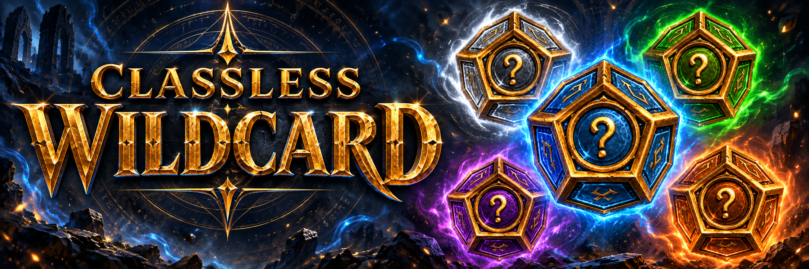
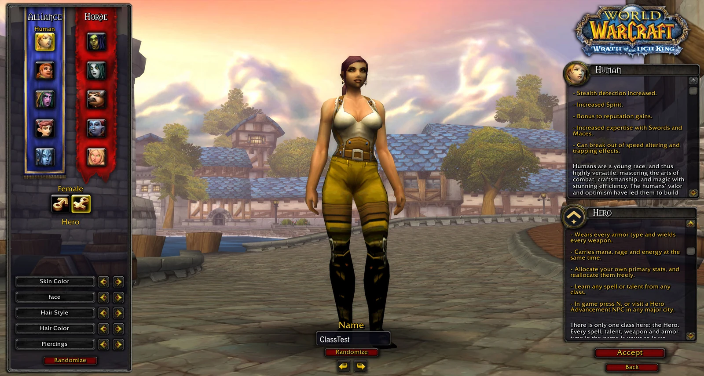
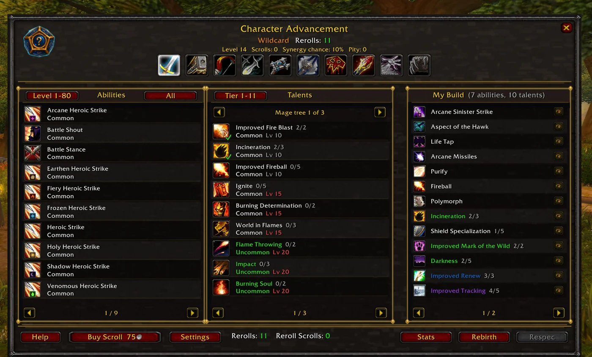
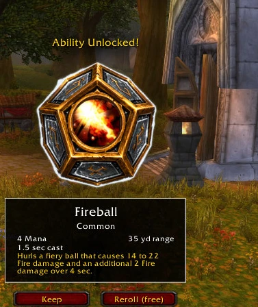
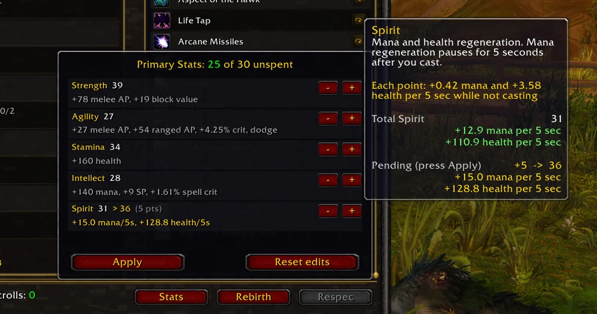
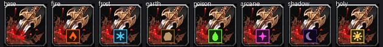

<div align="center">



<br>

[](https://www.azerothcore.org/)
[](https://www.azerothcore.org/)
[](src/)
[](client-addon/)
[](#license)

### An [AzerothCore](https://www.azerothcore.org/) module for WotLK 3.3.5a

**Every character can learn every spell and every talent from every class.** Buy them with
Essence, or let the server roll for you in Wildcard mode.

[Overview](#overview) · [Features](#features) · [Archetypes](#archetypes-and-my-builds) · [Wildcard rolls](#wildcard-rolls) · [Challenge runs](#challenge-runs) · [Hero line](#the-hero-line) · [Elemental variants](#elemental-variants) · [Commands](#commands) · [Install](#installation) · [Configuration](#configuration) · [Uninstall](#uninstall)

<br>

I build these as free, open source AzerothCore modules, and they stay free. If this one is
useful to you, you can support the work:

[](https://buymeacoffee.com/dustinhendrickson)

</div>

---

> [!CAUTION]
> **A total server overhaul, and experimental.** It replaces the class system and rebuilds
> progression, resources, stats, gear and quest access around it. Build a realm around it; do
> not add it to one you care about.
>
> - **Every player must run the [client patch](#client-every-player).** Without it the game is broken for them.
> - **Back up your world and characters databases** before the first start. Install is [reversible](#uninstall).
> - **Close World of Warcraft before running the client patcher**, or it cannot clear the client cache.

---

## Overview

There are no classes. Character creation offers a race and nothing else, and every character is
a **Hero**. Race keeps its racial traits. Every ability and talent is earned in game and can come
from any class.

There are two paths, chosen once per character (or forced realm-wide by config). A character
keeps its path for good, through Rebirth and challenge runs:

|                    | **Classless** (free pick)                                    | **Wildcard** (rolled)                                    |
| ------------------ | ------------------------------------------------------------ | -------------------------------------------------------- |
| How you gain power | Spend Ability Essence (AE) and Talent Essence (TE)           | The server rolls abilities and talents for you           |
| Level 1            | 3 AE to spend                                                | 4 random abilities                                       |
| Levelling          | +1 AE per level from 4, +1 TE per level from 10              | One roll per level from 10, alternating ability / talent |
| Cost               | Abilities 1 / 2 / 3 / 5 / 8 AE by rarity, talents 1 TE a rank | Free, weighted by rarity                                 |
| Changing your mind | Unlearn for a refund, or `.classless respec` for free        | Rerolls, Reroll Scrolls, ability locks                   |

Both paths share the same resources, stats, gear, NPC and addon.

---

## Screenshots

<div align="center">



<em><b>Character creation.</b> Pick a race. Every character gets all armour and weapons,<br>
every resource, and any spell in the game.</em>

<br><br>



<em>The <b>Hero Advancement</b> panel. Browse every class's abilities and talent trees,<br>
with your build on the right. Lock or reroll anything you own from the same window.</em>

<br><br>



<em>A <b>Wildcard</b> roll. Keep it, or spend a reroll.</em>

<br><br>



<em><b>Primary stats.</b> Spend points freely and reallocate for free.</em>

</div>

---

## Features

### Progression

- **Classless.** Buy abilities by rarity and talents a rank at a time. Talent prerequisites do not
  apply (Flurry needs no Thundering Strikes) and each talent tier opens at its level, with no
  points-in-tree requirement. Unlearning refunds the
  essence. Owned spells rank up as you level.
- **Wildcard.** Rarity-weighted rolls, ability locks, and synergy rolls that favour classes you
  already own. See [Wildcard rolls](#wildcard-rolls).
- **Rerolls.** Free below level 10. From level 10, each level grants 3 reroll charges for
  abilities and talents. Anything you own can be rerolled from **My Build**. Reroll Scrolls add
  more. The NPC and the panel's Buy Scroll button sell them from level 10, at a price that rises
  with level.
- **Archetypes.** Twenty Classless build templates from 1 to 80. Following one replaces your
  build, then buys each ability and talent rank with your essence as it unlocks. Stop any time
  and keep what was bought. Each fuses two classes around one or two elements, with three or
  more Hero line abilities and talents from more than one tree. Make, save and share your own
  with **My Builds**. See [Archetypes and My Builds](#archetypes-and-my-builds).
- **Rebirth.** At the level cap, start over at level 1 with a permanent rank that stacks.
  - **Kept:** your path, gold, bags, bank, reputation, riding, flight paths, and the **heirloom**
    abilities you choose to carry (usable from level 1, one more per rank).
  - **Reset:** your build and stat allocation. Worn gear goes into your bags, and anything that
    does not fit is mailed to you.
  - **Your choice:** before confirming you are asked whether to wipe your quest progress (quest
    log, completed quests and explored map) so every quest pays XP again, or keep it.
  - **Per rank:** +100% kill and dungeon XP for the first, +50% per rank after (max +300%); +3%
    to every primary stat (max +15%), which the Stats panel shows beside each stat; starting
    essence on the Classless path; a title (*the Reborn*, *the Twice Reborn*, *the Thrice
    Reborn*, *the Many-Lived*, *the Eternal*).
  - The gold price rises with rank. Start one from the panel's Rebirth button.
- **Challenge runs.** A life under one rule with limited lives. See [Challenge runs](#challenge-runs).

### Abilities and talents

- **Talents are in the Hero Advancement panel** at the rank you own, and in your spellbook. On the
  Classless path they cost Talent Essence, not talent points. The stock Talents window shows a
  tamed beast's pet talents.
- **Talents that teach a spell** (Pyroblast, Mortal Strike, Mangle and so on) are in the
  Abilities list instead, with every rank, at the level their tier opens.
- **General talents reach every class.** A talent that improves all of its class's abilities of
  one kind improves every ability of that kind, from any class: Fire Power every Fire spell,
  Impale every melee strike, Spiritual Healing every direct Holy heal, Benediction every instant
  mana spell. A talent that names particular spells, such as Improved Fireball, improves only
  those. The list is `cw_talent_reach`, written by `data/sql/generators/gen_talent_reach.py`,
  which also writes `talent_reach_report.txt` listing each widened talent and what it reaches.
- **Prerequisites come with the ability.** Cat Form brings Claw and Prowl, Charge brings Battle
  Stance, Kill Command brings a pet, Soul Shard spells bring Drain Soul. These are free, do not
  use a roll, and leave when nothing you own needs them.
- **No class tools.** Totem spells need no totem. Reagents are still needed. Runeforging still
  needs a runeforge.
- **Class passives come with their abilities.** Death Knight spells crit for double, Deep Freeze
  damages stun-immune targets, Flame Shock and Immolate can crit over time, and Chaos Bolt goes
  through absorbs.
- **Everything works together.** Any relic equips, shields work, Overpower, Revenge, Riposte and
  Counterattack all fire, feral attack power works in Cat and Bear form, and pets inherit your
  hit and expertise. Overpower opens for 5 seconds when your target dodges and uses no combo
  points, so a rogue or cat build's points are never lit up by it or spent on it. Item and set bonuses that pick their effect by class (Eye of Gruul, Soul
  Preserver, Flask of the North, the T3 six-piece bonuses) treat a Hero as every class, and
  Deathbringer's Will and Darkmoon Card: Madness roll from the list for your highest stat.
  Your heals draw normal threat (the core halves a Paladin's), and a Stable Master always
  offers the stable, whatever pet you have out.
- **Stances keep your rage.** Changing warrior stance keeps what your talents let a Warrior
  keep, entering one from no stance keeps it all, and switching your main bar or leaving a form never empties a pool.
  Stealth or Shadow Dance in a stance puts you back in that stance when it ends.
- **Class gates on vendors and trainers are open.** Every tier-10 vendor in Icecrown Citadel
  sells to you, any pet trainer resets a tamed beast's talents, and the holiday achievements
  that ask for a race and class of target ask for the race.
- **Pets do not mix.** Call Pet and the Stable Master only ever see your tamed beasts; a demon,
  ghoul or water elemental you put away is summoned fresh next time.
- **Tooltips count your talents.** Cost, cooldown, cast time, range, duration and values show what
  your build gives, including talents from other classes, and talent-reduced costs can be paid.
  Action buttons light up only when you can pay the cost the server will charge.
- **Summons leave with their spell.** Reroll Summon Imp away and the imp is dismissed. Reroll Tame
  Beast away and the beast is stabled; roll it again and the same beast returns. A tamed beast's
  pet talents open from the stock Talents button.
- **The Hero line.** 33 abilities that belong to no class, and a 23-talent Hero tree. See
  [The Hero line](#the-hero-line).
- **Elemental variants.** 27 weapon attacks in seven elements. See
  [Elemental variants](#elemental-variants).

### Resources and stats

- **Mana, rage and energy on every Hero.** Each spell uses its own resource. One shows on the main
  bar; the addon draws mini-bars for the rest.
- **Runes and runic power** for every Hero while Death Knight abilities are enabled (the default).
- **Primary stat allocation.** Points to spend across STR, AGI, STA, INT and SPI, reallocated
  free at any time.
- **Stats work for any build.** Agility gives melee and ranged attack power, and Intellect gives
  spell power.

### Gear and items

- **Every proficiency at level 1.** All armour, all weapons, dual wield and Parry, with Shoot
  and Throw. Weapon skills level by use. **Auto Shot** is taught while a bow, gun or crossbow is
  equipped and taken back when it comes off, because the client switches any character that
  knows Auto Shot into hunter mode on Attack. **Disable Auto Shot** in the panel's Settings
  keeps it off whatever is equipped; Shoot still fires a bow.
- **Armor weight.** Any Hero may wear any armor, and each type is a trade. Each piece worn in
  the eight armor slots counts toward its type, so a mixed set gets a share of each. A full set:

  | Armor | Effect |
  | --- | --- |
  | Plate | Casting 25% slower, attacks 8% slower |
  | Mail | Casting 12% slower, attacks 4% slower |
  | Leather | Attacks 4% faster, dodge 4% higher, casting 5% slower |
  | Cloth | Spell critical strike chance 4% higher, mana regeneration 10% faster |

  One **Armor Weight** aura on the buff bar stands for all of it; with the addon, hovering it
  shows each type worn with its pieces of 8, every effect as what you have now beside what a full
  set gives, and everything added together. It cannot be cancelled
  or dispelled. The numbers live in the auras' own spell rows (`ARMOR_WEIGHTS` in
  `gen_forged_spells.py`), and each can be set in the conf (`ArmorWeight.Plate.CastSpeed` and so
  on). `ArmorWeight.Enable = 0` turns it off.
- **Every item for every Hero.** Class armour sets, all 353 glyphs, rogue poisons, soul bags,
  quivers and relics. Sons of Hodir satchels give a random armour type.
- **Starter kit.** A neutral outfit, a bag, a spread of basic weapons (dagger, one- and two-hand
  swords and maces, an axe, a staff, a bow, a gun and throwing axes) with ammunition, a shield, and
  food and water.
- **Classless item catalogue.** 262 items with stat mixes no class had: intellect guns, strength
  staves, plate caster sets, spellpower shields, hybrid rings and more, levels 1 to 80. Armour
  and shield block match stock items of the same level. Sold by the NPC in level brackets and
  dropped by any mob near its level.
- **Hero heirlooms.** 23 items that scale from 1 to 80. Sold cheaply, and dropped by rares and
  world bosses.

### Granted for free

These are never rolled or bought. Every Hero receives them at these levels:

| Level | Riding                | Runeforging                                                   |
| ----- | --------------------- | ------------------------------------------------------------- |
| 20    | Apprentice Riding     |                                                               |
| 40    | Journeyman Riding     |                                                               |
| 55    |                       | Runeforging, Rune of Razorice, Rune of Cinderglacier          |
| 57    |                       | Rune of Spellshattering, Rune of Spellbreaking                |
| 60    | Expert Riding         | Rune of Lichbane                                              |
| 63    |                       | Rune of Swordshattering, Rune of Swordbreaking                |
| 68    | Cold Weather Flying   |                                                               |
| 70    | Artisan Riding        | Rune of the Fallen Crusader                                   |
| 72    |                       | Rune of the Stoneskin Gargoyle, Rune of the Nerubian Carapace |

Vendor, drop, reputation and quest mounts and companion pets work as normal. The five class mounts
(**Warhorse**, **Charger**, **Felsteed**, **Dreadsteed**, **Acherus Deathcharger**) are abilities,
rolled or bought at levels 20, 40 and 55.

### Quests

Every class quest chain is open to every Hero. A reward that would teach a class ability gives
nothing for that part; items, XP, gold and reputation are paid as normal.

### NPC and addon

- **Hero Advancement NPC.** In every capital, Dalaran and Shattrath. Advancement menu, gear
  vendor and Reroll Scrolls.
- **ClasslessWildcard addon.** The Hero Advancement panel (`N` by default), Wildcard roll UI,
  resource mini-bars, a first-login intro and path wizard (`/cw intro` replays the intro), and a
  Hero Guide in sections that quotes the realm's own numbers, armor weights included. Everything
  it does is also a chat command.

### Known limits

- On a core without AzerothCore's `CLASS_CONTEXT_WAND_SCHOOL`, a wand fires as Physical rather than
  its own school, so armor reduces it and school resistances do not. The module uses the context as
  soon as the core has it; the worldserver log says at startup which applies.
- Other UI addons are not supported. Anything that reads class, spellbook, talent frames or power
  type may display wrongly or throw errors.

---

## Archetypes and My Builds

An archetype is a build bought for you as you level. Classless only. Open it from the panel's
**Archetypes** button, which has two pages: **Starter Builds** (the realm's twenty) and
**My Builds** (your own). `/cw builds` opens My Builds.

### Starter builds

Each fuses two classes around one or two elements. The elemental strikes (*Fiery Heroic Strike*,
*Shadow Claw*, *Holy Aimed Shot* and the rest) carry the element, and the second class brings
spells of the same school.

They follow the same rule as a build of your own: every ability and every talent rank is an
entry with its own level, affordable at that level. **Copy to My Builds** opens one in the editor
with every level as the archetype sets it.

| Archetype | Classes | Elements | Plays as |
| --------- | ------- | -------- | -------- |
| *Cinderblade* | Warrior, Mage | Fire | Fiery strikes and cleaves with fireballs between swings |
| *Frostfire Duelist* | Rogue, Mage | Fire, Frost | Burning and frozen blades, Antipode Blast for both at once |
| *Ashen Reaver* | Warrior, Warlock | Fire, Shadow | Burning and shadowed strikes, curses, soul fire and a flame turret |
| *Plaguebringer* | Rogue, Warlock | Poison, Shadow | Envenomed blades, corruption and agony, a venom beetle |
| *Dawnstrider* | Hunter, Paladin | Holy, Arcane | Hallowed and arcane shots, seals and judgements up close |
| *Voidclaw* | Druid, Priest | Shadow | A shadow cat with shadow words and a shadowfiend |
| *Twilight Knight* | Warrior, Priest | Holy, Shadow | Holy and shadowed strikes behind a shield of faith |
| *Spellbow* | Hunter, Mage | Arcane, Frost | Arcane and frozen shots, traps, blink and ice lances |
| *Juggernaut* | Druid, Warrior | Earth | An earthen bear tank with warrior shouts and thunder |
| *Thunder Crusader* | Paladin, Shaman | Holy, Earth | Seals on a windfury blade, shocks, consecration and totems |
| *Wintertrap Ranger* | Hunter, Shaman | Frost | Frozen shots and traps, frost brand and earthbind |
| *Venom Prowler* | Druid, Rogue | Poison, Earth | An envenomed cat with rogue poisons |
| *Inquisitor* | Paladin, Rogue | Holy | Hallowed blades, seals and a divine shield |
| *Starfire Sage* | Druid, Mage | Arcane, Fire | Moonfire, starfire, fireballs and Antipode Blast |
| *Gravecaller* | Priest, Warlock | Shadow, Poison | Shields and heals for friends, plague and drains for foes |
| *Menagerie* | Hunter, Warlock | Fire, Shadow | A beast, demons, an infernal, a beetle, snakes and a turret |
| *Pyromaniac* | Mage, Warlock | Fire | Everything burns |
| *Con Artist* | Rogue, Priest | Shadow | Pick pockets, soothe, control minds, and a shadowed blade if talk fails |
| *Skinchanger* | Druid, Shaman | Earth, Frost | Wolf, bear, cat and flight form, healing between the changes |
| *Polymath* | Every class | | A signature from every class, tied together by Jack of All Trades |

### Following a build

- **Follow** replaces your build: what you own is refunded and reset, then the build's
  abilities and talent ranks are bought with your essence as each one unlocks. **Stop** ends it
  and you keep everything bought so far.
- Abilities are bought strictly in the order listed, and so are talent ranks. An entry that is
  waiting (for its level, or for essence) holds up everything after it in its list.
- An ability you already own is passed over at no cost. That includes abilities that come free
  with another entry: a form's kit (Battle Stance brings Charge, Defensive Stance brings Taunt,
  Bear Form brings Maul and Demoralizing Roar, Tame Beast brings Call Pet), the form an ability
  needs (Maul brings Bear Form), a talent's ability, and your heirlooms.
- **Build** on any archetype lists every ability and talent with the level it is bought at on
  your character. A starter build's list has **Copy to My Builds**, which opens it in the editor.

### My Builds

| Button | What it does |
| ------ | ------------ |
| **Save my build** | Your current abilities and talents as a new build, abilities in the order they unlock |
| **New** | An empty build |
| **Import** | Paste a build code. It opens in the editor (`/cw import` does the same) |
| **Edit**, **Share**, **Delete** | On each saved build |
| **Follow** | Follow the saved build, as above |

Saved builds are stored by the addon on your computer and shared by every character on the
account. The list scrolls when it outgrows the window.

### The build editor

A build is edited in the panel's My Build column. While the editor is open, the Abilities and
Talents lists show every level and become the picker:

- **Click** an ability to add it, or a talent to add one rank. **Right-click** takes an ability
  out, or a talent down one rank. Nothing is bought. Rows in the build are tinted and ticked.
- Each row in the editor shows the **level it is bought at**, and that level belongs to the
  row alone: changing one row never moves another. Change it three ways:
  - **Click the level** and type one. Enter or clicking away keeps it, Escape keeps the old one.
  - **Mouse wheel** over the level, one level a notch. The row stays put while the wheel turns
    and moves to its place in the list when the wheel stops.
  - **Arrows**, one level sooner or later.
- The earliest level for an entry is the level it becomes available at (an ability's unlock, a
  talent's tier), and the build must have the essence for it there: what a Hero has earned by
  that level covers it and every entry set at or before it. An entry set sooner stops at the
  earliest level that is true. A new entry goes in at the earliest such level, and one the
  essence never reaches by the level cap is refused. A level later than the earliest
  **holds it back** (shown in gold).
- Each **talent rank** is a row of its own with its own level: *Improved Heroic Strike 1/3* at
  10, *2/3* at 12, *3/3* at 15. A rank comes no sooner than the rank before it and no later
  than the rank after it. Click a talent in the list for the next rank; right-click takes the
  highest rank out, and a row's minus button takes out that rank and the ones above it.
- A build saved before entries had their own levels is set, the first time it is opened, to the
  levels it was bought at, with each talent split into a row per rank.
- Rows marked **free** come with another entry in the build and cost no essence.
- The minus button takes a row out. Rows with a problem are marked in red and say why in their
  tooltip. **Fix order** appears when order can fix it: abilities in unlock order, each talent
  after the talent it needs, ranks capped and repeats dropped.
- The bottom of the editor shows the Ability and Talent Essence the build spends against what a
  Hero earns by the level cap, and whether it fits. **Save** is enabled once it does. A build
  must fit a Hero with no Rebirth bonus, so it works for anyone it is shared with. The levels in
  the rows are for your own character, Rebirth essence and heirlooms included.
- A build holds up to 200 abilities and 200 talents, with a name of up to 32 characters and a
  description of up to 120.
- **Close** or **Escape** leaves the editor. With unsaved changes it asks first.

### Sharing

A build travels as a code starting `CWA1:`. **Share** shows it selected, ready for Ctrl+C, to
paste in chat, a forum or a message. **Send to party** sends it to your party or raid: members
with the addon are asked whether to view it, and it opens in their editor. A code carries the
levels the build holds entries back to.

---

## Wildcard rolls

From level 10 you get one roll a level: an ability on even levels, a talent on odd ones.
`.wildcard status` shows your reroll charges, synergy chance and reroll cooldowns.

- **Rolls only add.** Each roll grants one thing you do not already own. Nothing is ever replaced.
- **What can roll.** Any ability you do not own whose learn level you have reached, weighted by
  rarity. If nothing is available at your level, the lowest-level remaining entries are used.
- **Synergy.** A synergy roll only offers entries sharing a class with something you own. The
  chance is 10%, plus 10 points per pity. Pity rises with each reroll and resets on a synergy roll
  or Rebirth.
- **Reroll cooldowns.** A rerolled pick cannot come back for the next 24 rolls. If everything is
  owned or on cooldown, the cooldowns are released.
- **Locks.** Below level 10, a padlocked ability is skipped by the starting hand's "Roll
  Abilities" button and cannot be rerolled. Set padlocks from the starting hand, My Build, the NPC
  or `.wildcard lock`. They clear at level 10.
- **Talent ranks.** A talent roll also rolls its rank, and a fresh talent can land at any rank up
  to its top one. Higher ranks are rarer, weighted 100 / 75 / 50 / 25 / 10 for ranks 1 to 5.
- **Deepening a talent.** When rerolling a talent you can stake Reroll Scrolls to keep it and raise
  its rank instead. Each scroll adds 20% (five is certain). On a win the new rank can jump more
  than one; on a loss the scrolls are spent and the talent is rerolled as normal.

### Rarity

Rarity sets roll odds, Classless price and colour. It comes from the strongest of:

| Signal      | Uncommon | Rare  | Epic   | Legendary |
| ----------- | -------- | ----- | ------ | --------- |
| Cooldown    | 30 s     | 60 s  | 3 min  | 10 min    |
| Talent row  | 2        | 4     | 6      | 8         |
| Learn level | 25       | 50    |        |           |

Roughly 53% of abilities are common, 14% uncommon, 16% rare, 10% epic and 7% legendary. Fireball,
Backstab, Kick and Polymorph are common; Divine Shield, Ice Block, Mortal Strike and Bloodlust are
epic; Lay on Hands, Rebirth and the 41-point talents are legendary.

---

## Challenge runs

A run is one life under one rule, on the character's own path. Challenge runs start before level 2
(`ModeChoiceDeadline`).

- **Lives.** Each death costs one, falls and drowning included. Deaths in battlegrounds and arenas,
  and while dueling, are free. At zero, the run ends and you keep everything. A Rebirth also ends a run.
- **Finish** by reaching the level cap with a life left (Nemesis also asks for its Vengeance).
  Finishing grants the challenge's title and reward ability. Its gold is paid on the first finish only.
- **Flawless.** Finish without losing a life (on unlimited runs, without dying) for the title
  *the Unbroken* and a third more shards.
- **Shards.** Paid whenever a run ends: one per level, two per level past 60. 30 shards buy an
  extra life for your next run. You can hold one at a time.
- **Tracker.** While a run is live, a small frame at the top of the screen shows the challenge,
  your lives, and what the rule is counting: Hourglass's level clock as a draining bar, whether
  Pursued's hunter is on you, your nemeses (named on hover), and Berserker's health band. Drag it
  to move it, click it for the challenge page. Hide or show it under Settings or with `/cw tracker`.

Elite World's elites, a nemesis and Pursued's hunter take their health and damage from the realm's own
creature rates in `worldserver.conf` (`Rate.Creature.Elite.Elite.*` for elites,
`Rate.Creature.Elite.RAREELITE.*` for rare elites). A realm that sets every rank to the same rate
makes them no tougher than a normal creature. Suggested values, each rank tougher than the one
before (set the `SpellDamage` lines to the same numbers as the `Damage` lines):

```
Rate.Creature.Normal.HP              = 2
Rate.Creature.Elite.RARE.HP          = 2.5
Rate.Creature.Elite.Elite.HP         = 3
Rate.Creature.Elite.RAREELITE.HP     = 3.5
Rate.Creature.Elite.WORLDBOSS.HP     = 4

Rate.Creature.Normal.Damage          = 1.5
Rate.Creature.Elite.RARE.Damage      = 1.75
Rate.Creature.Elite.Elite.Damage     = 2
Rate.Creature.Elite.RAREELITE.Damage = 2.25
Rate.Creature.Elite.WORLDBOSS.Damage = 2.5
```

These apply to every creature of each rank on the realm, dungeon and raid elites included.

| Challenge       | Lives | Rule                                                                                       | Gold | Title              | Reward           |
| --------------- | ----- | ------------------------------------------------------------------------------------------ | ---- | ------------------ | ---------------- |
| Nemesis         | Unlimited | The creature that kills you becomes your nemesis, a rare elite only you can see. Slay nemeses for Vengeance and trophies; finish at level 80 with 500 Vengeance. See [Nemesis](#nemesis). | 500  | the Nemesis        | Mark of the Nemesis |
| Elite World     | 5     | Every enemy is an elite for you alone, at the realm's elite rates, with elite XP, rare drop chances and the elite border. Rares are rare elites; enemies already elite are unchanged. Other players see and fight them as normal. | 750  | Bane of Giants     | Giantsbane       |
| Legion          | 4     | Each enemy calls two more the first time it engages you. They fight only you.              | 650  | the Legionbreaker  | One Against Many |
| Pursued         | 3     | Every 15 to 30 minutes, a rare elite hunter two levels above you chases you until one of you dies or you change maps. Only you can harm it, and it harms no one else. | 600  | the Hunted         | Turnabout        |
| Hourglass       | 3     | Level up in time or lose a life: 20 min below 20, 30 min to 60, 45 min after.              | 500  | the Swift          | Rewind           |
| Glass           | 3     | Half health, a third more damage from you (not your pet).                                 | 400  | the Unshattered    | Shatterpoint     |
| Spiteful        | 3     | Creatures reflect a fifth of the damage you deal them, past your armor and absorbs.         | 450  | the Scarred        | Spite Mirror     |
| Bloodpact       | 3     | Heals from spells, potions and players halved (not food); your damage heals you for 15% of it. | 450  | the Bloodthirsty   | Sanguine Pact    |
| Berserker       | 3     | Below 35% health: double damage, and your hits break snares. Above 75%: 30% less damage.    | 450  | the Berserker      | Brink            |
| Ironman         | 3     | White and grey gear only.                                                                  | 500  | the Ironclad       | Ironbound        |
| Big Game Hunter | 3     | Normal enemies give no XP. Elites, rares and bosses give full XP, quests give double.      | 400  | the Big Game Hunter | Trophy Hunt     |
| Dealt Hand      | Unlimited | Wildcard only. No rerolls, starting hand included: you play every ability and talent dealt. | 500  | the Fated          | Loaded Die       |
| Hardcore        | 1     | One death ends the run, two if you start it holding an extra life.                         | 1000 | the Deathless      | Last Breath      |

### Nemesis

Nemesis is a run with unlimited lives, built around enemies of your own. The creature that kills
you becomes your nemesis, and with *Swear Vendetta* you can pick one yourself. Each nemesis is a
rare elite above your level that only you can see. It waits where it lives, grows stronger every
time it beats you, and drops a trophy when you finally put it down. Reach level 80 with 500
Vengeance, earned by slaying them, to finish.

#### Getting a nemesis

There are two ways.

- **Marked.** The creature that kills you is marked. It becomes a rare elite two levels above you,
  or at its own level if that is higher.
- **Sworn.** On a Nemesis run you learn *Swear Vendetta* (instant, 30 yards). Cast it on a creature
  to make it your nemesis on purpose. A Sworn nemesis fights four levels above you (or at its own
  level, if higher) and starts
  stronger, with Bloodlust and one more strength. It pays more for the kill. The target must be
  in the open world, at your level or above, and can't be an elite or a boss.
  You can have one Sworn nemesis at a time, and the spell has a 30-minute cooldown.

Deaths in dungeons and raids don't make a nemesis, and neither do deaths to elites, bosses, pets,
totems or summoned creatures.

#### What you see

Your nemesis is a private copy of the creature that only you can see and fight. The original is
hidden from you, while everyone else sees and fights it as it always was. The copy appears when
you come within sight of where it lives, and leaves when you go. It wears a red arrow over its
head, a rare elite border and a title on your target frame, and it has a dot on your minimap. Its
level is real, so the fight has the misses, dodges and resists of a higher-level foe. It keeps
that lead as you level.

#### Strengths and weaknesses

Every nemesis has at least one strength and exactly one weakness. Its strengths show the first
time you fight it; its weakness shows when you find it. Each time it kills you again, it grows
larger (up to twice its size) and gains another strength, up to three.

| Strength | Effect |
| --- | --- |
| Bloodlust | Attacks and casts 30% faster |
| Ironhide | Takes 25% less physical damage |
| Spellward | Takes 25% less spell damage |
| Venomous | Its hits poison you for 2% of your health every 2 seconds, for 6 seconds |
| Unyielding | Deals 25% more damage below 30% health |
| Warband | Calls two of its kind to its side, once a fight |
| Relentless | Regains 5% of its health a second out of combat |

| Weakness | Effect |
| --- | --- |
| A school (Fire, Frost, Shadow, Nature, Arcane or Holy) | Takes 50% more damage from it |
| Brittle | A stun ends its Unyielding rage, and it takes 20% more damage for 8 seconds |
| Cowardly | Flees at 20% health for 6 seconds, then takes 30% more damage |

#### Slaying a nemesis

Kill it yourself or with your pet. The kill pays:

- **Experience.** An elite's experience for its level, plus a bonus: a quarter of a level for a
  Marked nemesis, half a level for a Sworn one. The bonus isn't paid at the level cap.
- **Loot.** Classless gear at a rare's drop chance, heirloom roll included. A Sworn nemesis always
  drops a piece.
- **Vengeance.** Its level, or one and a half times its level if it was Sworn.
- **A trophy** (below).

If you are dead when it falls, it stays your nemesis.

#### Finishing the run

Reach level 80 with **500 Vengeance**. Both are needed: reaching 80 first doesn't end the run, it
ends the moment your Vengeance reaches 500. Since a nemesis's level follows yours, the same kill is
worth more later in the run.

#### Trophies

Every nemesis you slay drops a trophy into your bags, named for one of its strengths, chosen at
random. A trophy has a star for each strength the nemesis had, plus one if it was Sworn, up to three.
Each effect has a value per star:

| Trophy of | Gives, per star |
| --- | --- |
| Bloodlust | 0.8% haste |
| Ironhide | 2% armor |
| Spellward | 6 resistance to every school |
| Venomous | 0.4% critical strike chance |
| Unyielding | 1.2% maximum health |
| Warband | 1.2% attack power and spell power |
| Relentless | 0.8% to all primary stats |

So a Trophy of Bloodlust III gives 2.4% haste. Trophies work from your bags for the rest of the
run; nothing is equipped. Every trophy you carry counts, so four Bloodlust trophies give four
trophies' worth of haste. You can carry four. A fifth waits until you destroy one, and the same
goes for one that arrives when your bags are full.

Trophies stay in your bags. They can't be banked, sold, traded, mailed or auctioned, only
destroyed. They only work on the run, and a run that ends without finishing (a Rebirth included)
takes them away.

#### The Nemesis Charm

Finishing a Nemesis run turns your trophies into something permanent. For each kind of trophy
you hold, the best one adds its stars to that effect's rank on your **Nemesis Charm**. Each effect
on the charm goes up to rank 5. Other trophies of the same kind add nothing, and all of them are
used up.

The charm gives its ranks at the same per-star values, all the time, on every run and off them. It
stacks with the trophies of a later run. It sits in your bags like a trophy, can't leave them, and
can't be destroyed. If it is ever missing it is made again, or mailed to you when your bags are full.
Filling it takes several finishes across Rebirths. A full charm gives 4% haste, 10% armor, 30
resistance to every school, 2% critical strike chance, 6% maximum health, 6% attack power and spell
power, and 4% primary stats.

Trophies and the charm change your stats directly rather than through a buff, so nothing can be
clicked off. Their items carry no stats of their own; the addon's tooltip shows what each gives on
your realm.

#### In the addon

- The challenge tracker counts your Vengeance. Hover it for each nemesis: its title, Marked or
  Sworn, how far above you it fights, what you have learned of it, and where it lives.
- The world map shows a skull where each nemesis lives.
- Slaying a nemesis and swearing a vendetta each show a banner.

#### Configuration

The numbers above are the defaults. Each is a `ClasslessWildcard.Nemesis.*` option in the
configuration file, listed under [Configuration](#configuration).

### Reward abilities

Granted as heirlooms: usable from level 1, kept through every Rebirth, never rerolled. They cannot
be rolled or bought.

| Ability             | What it does |
| ------------------- | ------------ |
| Mark of the Nemesis | Marked enemy takes 15% more damage from you. If it dies marked, you regain 20% health and mana and the mark jumps to the nearest enemy. |
| Giantsbane          | 120% weapon strike, +1% per 1% of max health the target has over you, up to double. |
| One Against Many    | 10 sec: 5% more damage dealt and 5% less taken per enemy within 10 yards, up to five. |
| Turnabout           | 8 sec: when the next enemy hits you, you appear behind it and stun it for 4 sec. It takes 50% more damage from you while stunned. |
| Rewind              | After 6 sec, or on cancel, return to where you stood with the health, mana, rage and energy you had. |
| Shatterpoint        | Spend 30% of current health. The ice shard adds three times that, and shatters into enemies within 8 yards for half. |
| Spite Mirror        | 6 sec: a third of damage taken is returned as Shadow damage. |
| Sanguine Pact       | 10 sec: hits heal you for 30% of their damage. Overhealing becomes a shield up to 20% of max health. |
| Brink               | 8 sec: you cannot die, and deal 2% more damage per 1% missing health, up to double. |
| Ironbound           | 10 sec: armour equal to half your max health, and stun immunity. |
| Trophy Hunt         | Mark an elite, rare or boss. If it dies marked: 5% more damage and healing for 5 min, stacks three times. |
| Loaded Die          | Instant Holy damage for each point a 20-sided die shows. A 1 is thrown again, once; a 20 resets the cooldown. |
| Last Breath         | Passive. Once every 5 min a killing blow leaves you at 1 health, and for 6 sec your hits heal you for their full damage. |

---

## The Hero line

Thirty-three abilities that belong to no class, in their own **Hero** spellbook tab. Bought,
rolled and ranked like any other ability.

| Ability | What it does |
| ------- | ------------ |
| **Makeshift Strike** | Weapon strike that returns a little mana and rage |
| **Second Nature** | Restores a percentage of your mana, rage and energy |
| **Reclaimed Sentry** | A turret that fires on nearby enemies and strips armour |
| **Venom Beetle** | A pet that learns more poisons as you level. It has a pet bar and stays through logout |
| **Cairn**, **Waystone**, **Signal Fire**, **Rally Point** | Placed markers that help allies or hurt enemies near them |
| **Quickening** | Spends all your rage and energy for attack and casting speed |
| **Repertoire** | Rewards using a different ability each time |
| **Wildcard Surge** | Arcane damage that grows with your Epic and Legendary abilities |
| **Antipode Blast** | Fire and Frost in one cast, with a burn |
| **Hurl**, **Wide Arc**, **Crossdraw**, **Ricochet Shot** | A throw, a sweep, a spell-then-strike combo, and a bouncing shot |

### Hero talent tree

Twenty-three talents in four columns. Highlights:

| Talent | Effect |
| ------ | ------ |
| **Two Schools** | More damage when you hit in a different school from your last hit |
| **Jack of All Trades** | More damage and healing for every three classes you own an ability from |
| **Improvised Arsenal** | Makeshift Strike lowers Hurl's cooldown |
| **Field Repairs** | Second Nature and Adrenaline break snares and roots |
| **Last Reserve** | Ward Off refunds part of its cooldown when its shield is fully absorbed |
| **Opportunist** | Fistful of Grit, Vertigo and Sinkhole give energy per enemy caught |
| **Weave** | Every few Hero abilities you cast, one is free |
| **Field Study** | Emberfeed refunds part of its cost against a target bleeding from Bleed Over |
| **Venom Handler** | Your beetle's poison spreads from enemies that die with it |
| **Medicinal Venom** | Your beetle heals the most hurt party member |
| **Broad Strokes** | Overflow's spill always reaches you |
| **Overclocked** | Reclaimed Sentry fires twice as often |
| **Ricochet Chamber** | Ricochet Shot bounces again |

The other ten improve placed markers (*Scavenger's Eye*, *Wider Net*, *Quick Deploy*), reach and
area (*Long Reach*, *Wide Swing*), costs and cooldowns (*Thrift*, *Overdraw*), Hero ability crits
(*Sharpened*), Repertoire (*Encore*) and Quickening (*Adrenal Surge*).

---

## Elemental variants

<div align="center">



<em>Left to right: the base attack, then Fire, Frost, Earth, Poison, Arcane, Shadow, Holy.</em>

</div>

Twenty-seven weapon attacks come in seven elemental forms each. A variant keeps its base's cost,
cooldown, combo points and ranks, and deals its damage as the element: armour does not reduce it,
resistance does, and bonuses to that school apply. It keeps 85% of the weapon damage (75% for
Holy) and adds an effect:

| | Element | Effect |
| :-: | ------- | ------ |
|  | Fire | Burns over 6 sec |
|  | Frost | 30% movement slow for 6 sec |
|  | Earth | 10% attack speed slow for 6 sec |
|  | Poison | Poisons over 12 sec |
|  | Arcane | An extra hit |
|  | Shadow | 20% healing reduction for 6 sec |
|  | Holy | Heals you for 25% of the damage dealt |

Fire, Poison, Arcane and Holy scale with spell power as well as attack power. On an attack with a
duration of its own, the effect lasts as long as the attack's. Overpower, Maim and Mangle, plus the
Shadow and Poison forms of Mortal Strike and Aimed Shot, get an extra hit of their element instead
of its effect.

**Attacks with variants:** Sinister Strike, Backstab, Ambush, Hemorrhage, Heroic Strike, Cleave,
Whirlwind, Overpower, Mortal Strike, Devastate, Raptor Strike, Multi-Shot, Aimed Shot, Kill Shot,
Claw, Shred, Ravage, Maul, Maim, Swipe (Cat), Mangle (Cat), Mangle (Bear), Fan of Knives, and with
Death Knight abilities enabled, Blood Strike, Plague Strike, Obliterate and Death Strike.

Variants are one rarity above their base, roll less often, and file under the base attack's
spellbook tab. You can own a base attack and its variants together.

---

## Commands

### `.classless`

| Command | What it does |
| ------- | ------------ |
| `.classless status` | Path, how many abilities and talents you own, essence, reroll charges, cooldowns |
| `.classless mode classless\|wildcard` | Choose your path, at level 1 |
| `.classless learn <spellId>` | Buy an ability |
| `.classless unlearn <spellId>` | Drop an ability for a refund |
| `.classless talent <talentId>` | Buy the next rank of a talent |
| `.classless respec` | Unlearn everything except heirlooms, free, full refund |
| `.classless stats` | Show stat allocation and remaining points |
| `.classless stat str\|agi\|sta\|int\|spi <points>` | Allocate stat points |
| `.classless bar mana\|rage\|energy\|default` | Choose which resource the main bar shows |
| `.classless archetypes` | List archetypes and their IDs |
| `.classless archetype <id>` | Follow an archetype. `0` stops |
| `.classless rebirth [ability IDs] confirm` | Rebirth at the level cap, carrying the listed heirloom abilities |
| `.classless challenges` | List challenge runs |
| `.classless run <id>` | Start a challenge run, after choosing a path and before level 2 |

`learn`, `unlearn`, `talent`, `respec`, `archetypes` and `archetype` are for the Classless path.

### `.wildcard`

| Command | What it does |
| ------- | ------------ |
| `.wildcard status` | Same as `.classless status` |
| `.wildcard reroll <spellId>` | Reroll an ability |
| `.wildcard rerolltalent <talentId> [scrolls]` | Reroll a talent, optionally staking scrolls to raise it instead |
| `.wildcard lock <spellId>` | Toggle an ability's padlock |

### Addon

| Command | What it does |
| ------- | ------------ |
| `/cw` or `/classless` | Open the Hero Advancement panel |
| `/cw help` | Open the guide |
| `/cw hand` | Open the starting hand (Wildcard, below level 10) |
| `/cw builds` | Open My Builds (Classless) |
| `/cw import` | Paste a build code (Classless) |
| `/cw tracker` | Hide or show the challenge tracker |
| `/cwbars` | Toggle the resource mini-bars |
| `/cwbars show \| hide` | Show or hide the mini-bars |
| `/cwbars lock \| unlock` | Pin or unpin the mini-bars |
| `/cwbars reset` | Move the mini-bars back under the player frame |

On first run the addon binds the panel to `N`, the stock Talents key. If `N` holds something
else, it takes the first free key of `Y`, `G`, `K`. If the stock Talents window is left with no key,
it gets `J`; that window shows a tamed beast's pet talents. Rebind under **Key Bindings > Hero
Advancement**, which also has keys for the Help guide and the mini-bars. The panel's **Settings**
button shows, locks and resets the mini-bars and toggles each row, shows or hides the challenge
tracker, and can disable Auto Shot for the character. Right-click the minimap button
to toggle the mini-bars.

---

## Installation

### Requirements

- An AzerothCore **master** build you can recompile. No core edits needed.
- A **3.3.5a** client for every player, with **Python 3.7+** and Pillow for the installer.
  `install.bat` and `install.sh` install Pillow if it is missing.
- Optional: `mod-playerbots`, on the AzerothCore fork it requires. See [Playerbots](#playerbots).

### Server

1. Clone into `modules/`:

   ```bash
   git clone https://github.com/DustinHendrickson/mod-classless-wildcard.git azerothcore-wotlk/modules/mod-classless-wildcard
   ```

2. Re-run CMake and rebuild the worldserver.
3. Start the worldserver. The DB updater applies the module SQL. These lines in the log are
   expected and mean the module's replacement scripts are in place:

   ```
   Script named 'spell_dru_frenzied_regeneration' is not assigned in the database.
   Script named 'spell_pal_judgement_of_wisdom_mana' is not assigned in the database.
   Script named 'spell_pet_hit_expertise_scalling' is not assigned in the database.
   Script named 'spell_dk_blade_barrier' is not assigned in the database.
   Script named 'spell_dk_death_rune' is not assigned in the database.
   Script named 'spell_item_healing_trance' is not assigned in the database.
   Script named 'spell_item_soul_preserver' is not assigned in the database.
   Script named 'spell_pal_blessing_of_faith' is not assigned in the database.
   Script named 'spell_item_flask_of_the_north' is not assigned in the database.
   Script named 'spell_pal_t3_6p_bonus' is not assigned in the database.
   Script named 'spell_sha_t3_6p_bonus' is not assigned in the database.
   ```

4. Copy `conf/classless_wildcard.conf.dist` next to `worldserver.conf` as
   `classless_wildcard.conf` and edit it.

The SQL writes to core world tables (items, quests, creation info, creatures, vendors and the
spell and talent DBC tables). Most original values are backed up first and restored by
[uninstall](#uninstall); see its list of what is left behind.

> If you installed before September 2026, run
> `SELECT * FROM acore_world.updates WHERE name = 'cw_classless_items.sql';`. If it returns a
> row, your `item_template` class masks have no backup and only your own backup restores them.

### Client (every player)

Give players the `client-patch` and `client-addon` folders. With WoW **closed**, they run
`install.bat` on Windows or `./install.sh "/path/to/WoW"` on macOS and Linux. On a Mac the
installer patches the realm's `World of Warcraft.app` (a [wowdecomp](https://github.com/DustinHendrickson/wowdecomp/tree/macos-arm64)
build) the way it patches `Wow.exe`. See [`client-patch/README.md`](client-patch/README.md).

After that, updates are two steps: `update.bat` (or `./update.sh`) fetches the latest
patch and addon from this repository into those two folders, then `install.bat` installs
them. Players never need a fresh download.

It installs the addon, shows every class as **Hero**, replaces the class picker with one Hero
entry per race, adds names, tooltips and icons for the new spells and items, clears the client
cache, and patches `Wow.exe` to allow custom interface files (backed up first). Your original
game archives are not edited. `--uninstall` returns the client to stock.

Client and server must come from the same version of the module. After a server update, players
re-run the installer. If an item shows a question mark or a ranged weapon says "Out of range",
delete the `Cache` folder in the WoW directory and log back in.

#### When you build a new Mac client

Players only ever run `./install.sh`. This is for you, and only when you rebuild
`World of Warcraft.app` from wowdecomp and give players the new app. Updating this module, or
the server, does not need it.

The Mac patch is a list of exact byte changes for one build of the app, the way the Windows
patch only fits `Wow.exe` 12340. A rebuild moves the code, so until the new build is added,
`./install.sh` refuses it with "a build the Hero patch does not know" and changes nothing.

To add it, on any PC with Python (Windows works), from `client-patch`:

1. Once: `python3 -m pip install --user capstone keystone-engine unicorn`
2. `python3 gen_mac_patch.py "/path/to/World of Warcraft.app"`. It adds the build to
   `mac_patch.json` and keeps the builds already there, so players on the old app can still
   install.
3. `python3 test_mac_patch.py "/path/to/World of Warcraft.app"` must end with
   `all Mac patch checks pass`.
4. `python3 selftest.py "/path/to/your/WoW folder" --macapp "/path/to/World of Warcraft.app"`
   must end with `all checks passed`.
5. Commit and push `mac_patch.json`, then give players the new app. They run `./update.sh` and
   `./install.sh` as usual.

Use the app exactly as the build made it, never one the installer already patched. If step 2
prints `Not written:` and names a site, or step 3 fails, the rebuild changed code the patch
relies on, and `gen_mac_patch.py` needs updating before players get that build. Details are in
[`client-patch/MAINTAINERS.md`](client-patch/MAINTAINERS.md).

### Playerbots

Random bots keep their real class, abilities, talents and gear rules, and show as Hero. A random
bot is any character on an account starting with a prefix in `ExemptAccountPrefixes` (default
`rndbot`). If your bot accounts use another prefix, add it, or the bots become Heroes and lose
their abilities.

Your own characters logged in as bots (altbots) are Heroes. They fight with the abilities they own
through the `classless` strategy, which the module puts on them by itself:

- Each of the Hero's abilities is sorted by what it does: direct damage, damage over time, area
  damage, heals, heals over time, shields, interrupts, taunts, buffs, debuffs, crowd control,
  stuns, roots and fears around itself, defensive and offensive cooldowns, pets, and stances or
  forms. The bot casts from that list, paying from whichever pool each spell uses.
- Out of combat it buffs everyone in its party and keeps its pet summoned. In combat it buffs only
  itself.
- It uses long crowd control such as Polymorph on the enemy marked with the crowd control raid
  icon, or on an add no tank is holding. A stun or silence stops a cast when no interrupt is ready.
  A ranged Hero or healer roots or fears enemies that reach it once its health drops. A fear on
  one enemy is cast only on the enemy marked with the crowd control raid icon, or on an enemy
  hitting a ranged Hero or healer.
- In combat it keeps one totem down for each element: one that attacks when an enemy is within its
  reach, otherwise one that helps the party. A totem left behind is replaced. Tremor, Grounding,
  Earthbind, the cleansing totems and totems with a long cooldown are left to you.
- It calls temporary fighters such as Water Elemental or Feral Spirit against an elite, a boss, a
  player or two or more enemies, and not again while one is out.
- When its damage spells reach less far than playerbots' spell distance, it walks in until one is
  in range.
- The bot takes a role from its abilities: healer when heals are a large share of them, tank when
  it has a taunt and fights up close, otherwise melee or ranged damage by where most of its damage
  reaches from. Choose one yourself with `co +classless tank`, `co +classless heal`,
  `co +classless melee` or `co +classless ranged`. The choice lasts until the bot logs out.
- The chassis class's own combat strategies are taken off, and taken off again whenever
  playerbots resets the bot.
- A Hero bot ignores `maintenance` and the talent commands, which would replace its talents with a
  chassis class spec.
- A Classless bot that follows an archetype buys that build's abilities and talents as it levels.
  One that follows none buys nothing; its essence waits for you to log in and spend it. A Wildcard
  bot gets its level-up rolls like any Wildcard Hero, and its rerolls wait for you.

### Difficulty

Heroes are stronger than classes, and some combinations are much stronger. The module does not
change creature tuning. To make the world harder, raise creature rates in `worldserver.conf`:

```
Rate.Creature.Normal.HP                = 1.5
Rate.Creature.Normal.Damage            = 1.3
Rate.Creature.Normal.SpellDamage       = 1.3
Rate.Creature.Elite.Elite.HP           = 1.5
Rate.Creature.Elite.Elite.Damage       = 1.3
Rate.Creature.Elite.Elite.SpellDamage  = 1.3
```

The same rates exist for `RARE`, `RAREELITE` and `WORLDBOSS`. Raise damage along with health.

---

## Configuration

All settings are in [`conf/classless_wildcard.conf.dist`](conf/classless_wildcard.conf.dist),
documented inline and prefixed `ClasslessWildcard.`. The common ones:

| Setting | Default | Meaning |
| --- | --- | --- |
| **Paths** | | |
| `Enable` | `1` | Master switch |
| `DefaultMode` | `0` | `0` Classless, `1` Wildcard |
| `AllowModeChoice` | `1` | `0` forces `DefaultMode` for everyone |
| `ModeChoiceDeadline` | `2` | Level the path locks at. Challenge runs must start before it |
| `ExemptAccountPrefixes` | `rndbot` | Accounts whose characters keep their real class |
| `Rebirth.Enable` / `Rebirth.CostGold` | `1` / `100` | Rebirth; it costs this times (rank + 1) gold |
| `Rebirth.KillXpPctFirst` / `PerRank` / `Max` | `100` / `50` / `300` | Kill and dungeon XP bonus per Rebirth rank, % |
| `Rebirth.OtherXpPctPerRank` / `Max` | `25` / `100` | Quest, exploration and battleground XP bonus per rank, % |
| `Rebirth.StatPctPerRank` / `Max` | `3` / `15` | Primary stat bonus per rank, % |
| `Rebirth.LegacyAbilityEssence` / `LegacyTalentEssence` | `3` / `2` | Starting essence per rank, Classless |
| **Pool** | | |
| `IncludeDeathKnight` | `1` | Death Knight abilities, talents and runes |
| `Forged.Enable` | `1` | The Hero line. Only turn off before anyone has one |
| `Elemental.Enable` | `1` | Elemental variants |
| `Elemental.RarityBump` | `1` | Rarity tiers above the base attack |
| `Elemental.RollWeightPct` | `8` | Roll weight, % of the base's |
| `Elemental.InPool` | `1` | `0` stops new variants being rolled or bought |
| `Elemental.ShowInBrowser` | `1` | Show variants in the addon and NPC |
| **Classless** | | |
| `Classless.StartingAbilityEssence` | `3` | AE at creation |
| `Classless.EssenceStartLevel` / `AbilityEssencePerLevel` | `4` / `1` | AE per level, from this level |
| `Classless.TalentEssenceStartLevel` / `TalentEssencePerLevel` | `10` / `1` | TE per level, from this level |
| `Classless.AbilityCostByRarity` | `1,2,3,5,8` | AE cost per rarity |
| `Classless.TalentFlatCost` | `0` | `1` charges rank 1 only |
| **Wildcard** | | |
| `Wildcard.StartingAbilities` | `4` | Abilities at level 1 (max 4) |
| `Wildcard.RollStartLevel` | `10` | First roll level |
| `Wildcard.AbilityEveryLevels` / `TalentEveryLevels` | `2` / `2` | Roll cadence |
| `Wildcard.RarityWeights` | `100,85,65,45,25` | Roll weight per rarity |
| `Wildcard.TalentRankWeights` | `100,75,50,25,10` | Roll weight per talent rank |
| `Wildcard.FreeRerollBelowLevel` | `10` | Rerolls are free below this level |
| `Wildcard.RerollsPerLevel` | `3` | Reroll charges per level from 10 |
| `Wildcard.SynergyBanRolls` | `25` | Reroll cooldown, in rolls |
| `Wildcard.TalentUpgradePerScroll` | `20` | % per staked scroll |
| `Wildcard.ScrollBuyBaseCopper` / `ScrollBuyPerLevelCopper` | `500` / `500` | Scroll price: base + per level × level |
| **Resources, stats, gear** | | |
| `UniversalResources.MaxRage` / `MaxEnergy` | `1000` / `100` | Pool sizes |
| `UniversalStats.SpellPowerPerIntellect` | `0.5` | Spell power per Intellect |
| `UniversalStats.MeleeAPPerAgility` / `RangedAPPerAgility` | `1` / `1` | Attack power per Agility |
| `Stats.Enable` / `Stats.StartingPoints` / `Stats.PointsPerLevel` | `1` / `4` / `2` | Stat allocation |
| `ArmorWeight.Enable` | `1` | Each armor type's aura (see Armor weight). `0` takes them away |
| `ArmorWeight.<Armor>.<Effect>` | empty | A full set's value, in percent; empty uses the aura's spell row |
| `Riding.Enable` / `Riding.Grants` | `1` / the table above | Free riding, as `spell:level` pairs |
| `Runeforging.Enable` / `Runeforging.Grants` | `1` / the table above | Free runeforging, as `spell:level` pairs |
| `WorldDrops.Enable` / `Chance` | `1` / `1.0` | Classless gear drops, % per kill |
| `WorldDrops.RareMultiplier` | `5.0` | Drop multiplier for rares and bosses |
| `WorldDrops.HeirloomChance` | `2.0` | Heirloom %, rares and bosses only |
| **Nemesis** | | |
| `Nemesis.MarkedLevels` / `SwornLevels` | `2` / `4` | Levels above the Hero |
| `Nemesis.MarkedBonusXpPct` / `SwornBonusXpPct` | `25` / `50` | Kill bonus, % of a level |
| `Nemesis.SwornCooldownMinutes` | `30` | Swear Vendetta's cooldown |
| `Nemesis.VengeanceToFinish` / `SwornVengeancePct` | `500` / `150` | The goal; a Sworn kill's Vengeance, % of its level |
| `Nemesis.TrophyMax` | `4` | Trophies carried at once |
| `Nemesis.BloodlustPct` / `IronhidePct` / `SpellwardPct` | `30` / `25` / `25` | Strengths: faster attacks and casts; less physical; less spell damage |
| `Nemesis.VenomousPct` / `VenomousSeconds` | `2` / `6` | Poison: % of health every 2 seconds, and how long |
| `Nemesis.UnyieldingPct` / `UnyieldingBelowPct` | `25` / `30` | More damage, below this % health |
| `Nemesis.WarbandCount` / `RelentlessPct` | `2` / `5` | Creatures called; % health a second out of combat |
| `Nemesis.WeakSchoolPct` | `50` | More damage from its weak school |
| `Nemesis.BrittlePct` / `BrittleSeconds` | `20` / `8` | More damage after a stun, and for how long |
| `Nemesis.CowardlyPct` / `CowardlyFleePct` / `CowardlyFleeSeconds` | `30` / `20` / `6` | More damage once fled; when it flees, and how long |
| `Nemesis.Star*` | see [Trophies](#trophies) | One star's worth in each trophy and charm effect |
| `NpcEntry` | `990100` | Hero Advancement NPC entry |

Any spell or talent's rarity, cost, roll weight and availability can be overridden in the
`cw_ability_override` and `cw_talent_override` world tables. Restart after editing.

---

## Uninstall

Characters keep the Hero base class after uninstalling. Restore a pre-install backup to get their
original classes back.

<details>
<summary><b>Steps</b></summary>

<br>

With the worldserver stopped:

1. Back up the world and characters databases.
2. Delete `modules/mod-classless-wildcard` and `classless_wildcard.conf`, re-run CMake and rebuild.
3. Run `data/sql/uninstall/cw_uninstall_world.sql`.
4. Run `data/sql/uninstall/cw_uninstall_characters.sql`.
5. Start the server. On next login, each character loses spells and skills invalid for their
   class, and talent points return.
6. Players run the client installer with `--uninstall`.

**Left behind:**

- The Hero line and elemental variant rows in the spell tables. They are inert. To remove them,
  delete ids `950000`-`957167` and `960000`-`962047` from the spell tables, `9000`-`9022` from
  `talent_dbc`, `990` from `talenttab_dbc` and `skillline_dbc`, and `180`-`197` from
  `chartitles_dbc`.
- Module tables: `cw_ability_variants`, `cw_ability_variants_meta`, `cw_forged_spells` and
  `cw_forged_meta` in the world database, `cw_char_runs` and `cw_char_nemeses` in the characters
  database.
- The Sons of Hodir satchel loot changes. `data/sql/manual/cw_class_loot_revert.sql` reverts them.
- The Hero race rows in `playercreateinfo` and `playercreateinfo_action`.
- Spells legal for the base class. A GM can `.unlearn` them.
- Characters created under the module have no class starter spells; class trainers teach them.

Uninstalling removes every Hero's build. Tell your players first.

</details>

---

## Contributing

Issues and pull requests are welcome. With a bug report, include your AzerothCore revision, the
module commit, your `classless_wildcard.conf` changes, and the worldserver log around the failure.

## License

GNU General Public License v2 or later, matching AzerothCore. See [`LICENSE`](LICENSE).

## Credits

Mechanics are modeled on the Season 9/10 rules of [Project Ascension](https://ascension.gg/)'s
classless and Wildcard realms. This project is unaffiliated with Project Ascension and Blizzard
Entertainment.
